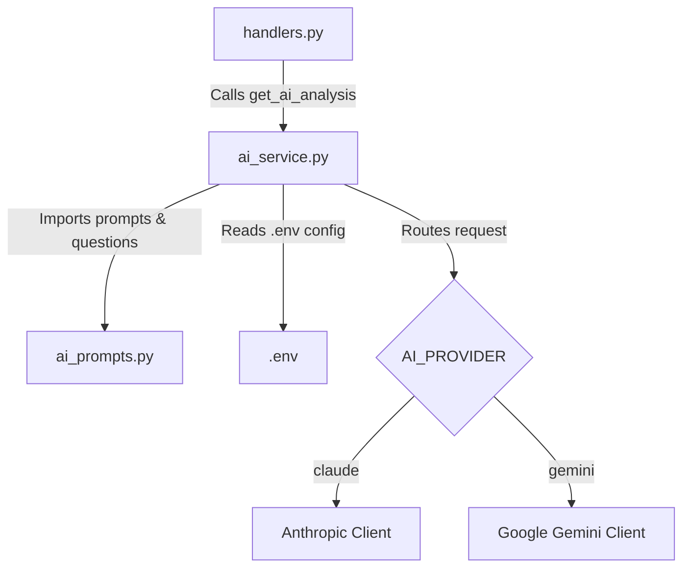

# Architectural Plan: Universal AI Analysis Service & Multi-Provider Strategy

## Objectives
1. **Decouple Prompts from Provider**: Move questionnaire dictionaries and system prompts out of [`claude_api.py`](claude_api.py:1) into a shared, provider-agnostic prompt manager (`ai_prompts.py`).
2. **Universal AI Analysis Interface**: Implement a unified `ai_service.py` exposing `get_ai_analysis(request_type, answers)`.
3. **Dynamic Model & Provider Switching**: Support configuring both provider (`AI_PROVIDER`) and model (`AI_MODEL`) via [`.env`](.env:1) at runtime without code modifications.
4. **Zero-Breaking-Changes Wrapper**: Provide `get_claude_analysis = get_ai_analysis` for seamless compatibility with [`handlers.py`](handlers.py:20).

---

## Proposed Project Structure



---

## Detailed Component Design

### 1. [`ai_prompts.py`](ai_prompts.py:1) (Decoupled Data & Instructions)
- Houses the complete `questions` dictionary (base questions, health, relationship, finance).
- Houses the `system_prompt` defining the psychologist persona, formatting rules, HTML tags (`<b>`, `<i>`), and constraints.
- Provider-agnostic: contains no references to Anthropic or Google.

### 2. [`ai_service.py`](ai_service.py:1) (Universal Analysis Engine)
- Reads configuration from [`.env`](.env:1):
  - `AI_PROVIDER`: `claude` or `gemini`
  - `AI_MODEL`: Specific model identifier (e.g. `claude-sonnet-4-6` or `gemini-1.5-pro`)
  - API Keys: `CLAUDE_API_KEY` and `GEMINI_API_KEY` (or `GOOGLE_API_KEY`)
- Exposes `get_ai_analysis(request_type, answers)`:
  1. Retrieves prompt templates and questions from [`ai_prompts.py`](ai_prompts.py:1).
  2. Constructs the user prompt payload.
  3. Dispatches the request to the active SDK client based on `AI_PROVIDER`.
  4. Returns the sanitized text response.
- Provides `get_claude_analysis = get_ai_analysis` alias for backward compatibility.

### 3. Dynamic Configuration via [`.env`](.env:1)
```env
AI_PROVIDER=gemini
AI_MODEL=gemini-1.5-pro
CLAUDE_API_KEY=your_claude_key_here
GEMINI_API_KEY=your_gemini_key_here
```
Users can switch between providers and models instantly by editing [`.env`](.env:1) and restarting the container.
